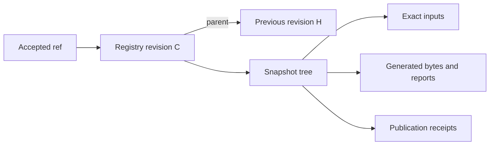

# Git as the record of validated graph snapshots

Research date: 2026-11-01. This records the alternatives and reasoning from the
first-principles Git review. Q25 subsequently accepted retaining generated
outputs and receipts with each accepted snapshot; the authoritative decision is
[ADR 0010](../adr/0010-retain-validated-outputs-with-acceptance.md), which supersedes
ADR 0006. The proposal language below preserves that evaluation; it does not
make every recommendation accepted or authorize implementation. Q13, Q14, Q16,
Q23, Q24, and Q26 were then accepted: retry/rejection, source-ordering, and shared
control-finalization contracts now live in ADRs 0011-0013 and the
[design discussion](../design.md). Their concrete hosted integration and formats
remain on the [design frontier](../design.md#current-decision-frontier).
Primary-source facts are collected in [Git primitives](git-primitives.md).

## Begin with the guarantees

A source PR is the review object. A check establishes evidence about identified
inputs. Subgraph publication accepts an authorized update into a complete valid
graph. Supergraph artifact publication makes exact generated bytes available.
Gateway activation selects one artifact. These operations have different
success conditions even when one implementation performs several of them.

The registry needs one decisive transition: accepting a complete graph relative
to the state it actually replaces. Every participating subgraph must be
authorized, and unrelated accepted changes must survive. Request delivery,
composition, compatibility assessment, artifact distribution, and deployment
are not one distributed transaction.

Recommended strengthening: use Git's object graph for exact snapshots and its
accepted commit history for durable acceptance evidence. Keep source CI in
charge of invoking checks and publication. A database, candidate inventory,
webhook subscription, or scheduler is not required by these guarantees.

## Three coherent alternatives

| Design | Interface and hidden work | Concrete benefit | Cost |
| --- | --- | --- | --- |
| One accepted input history; release artifacts follow | `check(updates, baseline)` and `publish(intent)` hide authorization, full analysis, source ordering, conditional writes, and receipt recovery. | Preserves the accepted direction while gaining content reuse and durable retry evidence. | Registry acceptance can succeed before output generation or release availability; those states need separate recovery. |
| Managed candidate branches | An explicit candidate handle supports revision, checking, and publication of a sealed set of updates. | Durable handoff and coordinated drafting across callers; interrupted checks can retrieve a retained candidate. | Adds candidate ownership, expiry, supersession, storage, and cleanup. A branch does not execute or recover work by itself. |
| Inputs and generated outputs in each accepted snapshot | The same small check/publish interface prepares all required bytes before the accepted ref changes. | Acceptance retains the exact result already validated; distribution can retry without recomposition. | Generated bytes enter Git history, and every input-changing writer must preserve the snapshot invariant. Revises ADR 0006. |

Recommendation: use the first design's small interface and single accepted
history, and consider the third design's complete snapshots now that a trusted
publication service is already required. Its benefit is eliminating a specific
generation/recovery gap, rather than adding branches for their own sake. Keep
the first design if generated-output size, host limits, or the control-PR
finalization workflow make complete snapshots disproportionately costly. Those
costs have not been measured.

The managed-branch design is justified if callers need durable drafts or a
service-owned promise to finish submitted work. Those are additional product
contracts. The present caller-owned retry model does not require them.

Publication already has to compose before accepting its conditional update.
Retaining that computed output binds acceptance to the bytes actually produced
by validation, instead of discarding them and generating again afterward. The
service creates shared generated files, so this need not add generated-output
churn to source PRs.

## Separate content, comparison, and acceptance identity

Git already stores immutable blobs, trees and commits. A commit also includes
parents and metadata, so two commits can identify the same input tree. Native
trees provide the required Merkle relationships without another object store.
[Git data model](https://git-scm.com/docs/gitdatamodel).

Use identities with different jobs:

| Identity | Meaning |
| --- | --- |
| Composition inputs | Exact SDL, routing/composition configuration, and all other consumed inputs, plus the composer/tool identity. |
| Check inputs | Ordered baseline and candidate composition identities, fixed baseline operations, proposed corpus changes, and checker/policy identities. |
| Publication intent | Stable identity bound to the requested subgraph replacements and source evidence, independent of registry contention or transport attempt. |
| Registry revision | Commit recording the accepted snapshot and request receipt. |
| Generated bytes | Digest of the actual supergraph, public API schema, or report bytes. |

A new source revision can advance provenance without changing the composition
input tree. A different baseline can change compatibility findings while the
candidate supergraph remains identical. A retry against a new registry head
keeps its publication intent but changes the candidate and comparison inputs.
One commit hash used for all of these purposes obscures those relationships.

Composition reuse is safe only for the complete dependency closure. Include
the executable identity and consumed configuration, not merely a human version
label. Preserve submitted bytes under a defined ingestion convention; do not
silently normalize SDL while claiming its original digest. Avoid embedding
timestamps, request IDs, or source metadata in deterministic generated content
unless they actually affect the result. Place run-specific evidence separately.

Unchanged subtrees can reuse bytes and previously established results. A new
combination of subgraphs still requires complete composition. Tree inequality
does not establish a semantic difference, and tree equality says nothing about
authorization or runtime readiness.

## One accepted ref, one complete snapshot

The proposed complete-snapshot layout is illustrative, not a file format:

```text
accepted commit
  parent: previously accepted commit
  tree:
    inputs/       complete graph, controls, operations, source evidence
    generated/    supergraph, public API schema, reports, build manifest
    receipts/     append-only successful publication records
```

The composition identity can select the appropriate input subtrees and tool
identity without depending on reports, receipts, or unrelated provenance.
Generated manifests identify those input trees and generated-byte digests;
they do not contain their enclosing commit's own final hash. External release
metadata can add that registry revision afterward. The parent identifies the
actual acceptance baseline.



Receipts bind a scoped request key to its payload digest, baseline, inputs and
generated outputs. A receipt stored in the same commit cannot include that
commit's own ID. The containing commit supplies it; an append-only receipt path
allows lookup of its introducing commit. An index can accelerate this lookup
but is rebuildable evidence, not another authority. A per-commit receipt in
history is a simpler storage alternative with a less direct lookup.

Acceptance requires a verified snapshot and receipt on the designated accepted
sequence. If maintainer merges introduce additional parents, use the accepted
first-parent sequence: an intermediate proposal being an ancestor of an accepted
merge does not make that proposal an accepted snapshot. Receipt recovery must
identify its introduction on that sequence. Creating a blob, candidate commit,
tag, or branch does not confer approval. Rejected speculative objects may be
discarded; returning an object ID from a check does not promise future retrieval.

## Publication is a validated conditional update

Proposed interface:

```text
check(subgraphUpdates, baseline = current) -> CheckReport
publish(publicationIntent) -> PublicationOutcome
```

The caller supplies stable source identities and exact authorized replacements,
not a replacement for the whole registry. The service owns this sequence:

1. Authenticate and scope the request. Resolve an already accepted identical
   intent before trying to apply it again; a key reused with different payload
   is an integrity error. Renewed authorization still applies to the caller.
2. Read accepted head H. Resolve its complete inputs and governing controls;
   verify source ordering for every submitted subgraph.
3. Construct the candidate by replacing only those subgraphs. Preserve all
   other subgraphs and maintained configuration from H.
4. Compose the complete candidate and generate the public API comparison and
   operation reports. Preserve compatibility failures under the externally
   managed bypass contract; input, composition, and tool failures remain
   distinct.
5. For a complete snapshot, prepare inputs, outputs and receipt together in a
   commit whose parent is H. Advance the accepted ref only if it still equals H.
6. If H changed, repeat against the new state, including authorization scope,
   source ordering, composition and comparison. Reuse only results whose full
   inputs still match. Return a bounded operational retry outcome on exhaustion.

Git's local old-OID ref condition supports this transition. GitHub documents
`expectedHeadOid` on `createCommitOnBranch`, and atomic `updateRefs` with
per-ref `beforeOid`. The latter could also install an immutable request-index
ref in the same repository transaction if a measured lookup need justified it.
Neither API creates a transaction with release assets or another repository.
[Local conditional update](https://git-scm.com/docs/git-update-ref),
[GitHub commit input](https://docs.github.com/en/graphql/reference/commits#createcommitonbranchinput),
[GitHub atomic ref update](https://docs.github.com/en/graphql/reference/git#updaterefs).

For concurrent A and B, A can advance H to H-A. B's stale conditional update
fails internally; B then constructs H-A-B, retaining A's changes, and validates
that combination. A successful textual merge is insufficient. Submitted SDL
is a whole generated subgraph replacement: splicing lines from two generated
schemas can create bytes produced by neither source build.

Proposed composition rejection remains tied to the evaluated head. Refresh
once that head is observed to have changed before returning a semantic failure.
If it remains current, return diagnostics without acceptance or automatic later
publication. No such response promises that the candidate will remain invalid
against future registry states. This is the pending Q23 decision.

## Recovery follows durable evidence

| Interruption | Proposed result and recovery |
| --- | --- |
| Before accepted ref movement | No registry acceptance; discarded prepared objects do not create pending work. Caller can retry. |
| Ref movement may have succeeded but response was lost | Reconcile the request receipt in accepted history. Do not infer absence from a timeout. |
| Request was accepted and later superseded | Return the original acceptance evidence. Never replay its older SDL into the current graph. |
| Registry acceptance succeeded but release upload failed | The recorded output remains available in Git under the complete-snapshot proposal. Retry distribution of those exact bytes. Report release availability separately. |
| Same declared build inputs produce different output bytes | Preserve existing accepted bytes and report a reproducibility failure; investigate instead of replacing output. |
| Git/host/source-history evidence unavailable | Report an operational or evidence-availability outcome, not successful analysis or a semantic composition conflict. |

Receipt lookup and conditional append together provide repeat-safe publication;
GitHub mutation IDs alone are not a deduplication contract. After a failed
condition, look up the intent again because another request instance may have
completed it. Identical input content does not mean two distinct source
revisions are interchangeable.

Complete snapshots narrow recovery obligations. They do not promise delivery
of an HTTP response, continuous release availability, or future automatic
processing after a rejected request. Immutable GitHub releases can remain the
distribution format, carrying the recorded bytes and external commit binding.
That distribution stage still needs its existing retry and retention contract.

To make the retained Git artifact directly useful, deployment tooling needs a
way to resolve an accepted registry revision, output path and byte digest into
the exact artifact. It can bundle those bytes into the gateway deployment; no
runtime Git connection is required. If releases remain the only selectable
store, acceptance still has a distribution-pending state. In that variant, Git
output storage improves retention and repeatability but does not collapse the
two-stage public lifecycle.

## Source ancestry is a different graph

Recommend ordering publications by the verified history of the configured
source repository/ref for each subgraph, rather than timestamps or arrival
order. A descendant can advance that subgraph; an overtaken ancestor is
superseded. A newer source revert can intentionally restore earlier SDL while
preserving forward history. Missing ancestry data is unavailable evidence;
divergent histories and intentional lineage changes need explicit handling.
This remains the pending Q24 decision.

The source SHA used in a PR check may be a synthetic merge, so post-merge
publication must identify the actual trusted build revision and submitted SDL.
Ancestry is not proof that SDL came from the claimed build. Authentication,
source-to-subgraph scope, and the claimed-versus-verified provenance contract
remain necessary. Do not import upstream source commits as registry parents
merely to encode provenance: registry acceptance order and upstream development
history answer different questions.

Preserve source progress even when SDL bytes are unchanged. Treat different SDL
at the same claimed source revision as a case needing a defined generation or
replacement identity, not an arrival-order tie-break. The exact generator
identity and supported source lineage have not yet been specified.

A coordinated publication submits one authorized batch. If any participant is
already overtaken, silently dropping that participant changes the batch's
meaning. Recommend returning a superseded-batch outcome with no new changes,
unless the exact intent was previously accepted. The caller can explicitly
choose a fresh complete batch. Independent requests need no shared source clock.

## Where branches help, and where they add work

Keep one accepted ref for a complete graph. Normal branches remain useful for
deliberate maintainer proposals. Candidate branches become useful for explicitly
requested durable drafting or handoff; their mere existence is not a scheduling
or completion guarantee.

Per-subgraph accepted branches require another manifest or transaction to name
the complete combination. That combination is the graph snapshot already
represented by a single tree. Updating one branch per subgraph does not establish
that the federation composes. Branches per source PR introduce ownership,
supersession and cleanup despite avoiding duplicate PR objects. No environment
branches or mutable latest-artifact pointers are needed by the agreed domain.

GitHub's atomic multi-ref support makes some richer designs feasible; it does
not remove their extra reader and retention contracts. Prefer reading one
immutable graph commit rather than independently reading mutable subgraph tips.

## The consequential costs of complete snapshots

The trusted service would generate shared outputs after authenticating scoped
source input. This need not give source automation permission to choose shared
output files, routing, policy, receipt paths or arbitrary Git modes. The same
checker remains usable through the portable CLI with ordinary directories.
Persist non-secret verified claims and evidence identities, not submitting
bearer credentials. A recorded source identity remains distinct from proof of
the build-to-SDL relationship.

Every accepted input-changing writer must preserve the relationship between
inputs and generated outputs. This includes maintainer policy, routing, corpus,
and toolchain changes. A direct control merge that carries old generated output
would violate the proposal. Maintainer ownership and review stay intact, but
their finalization workflow must build and verify the exact accepted snapshot
too. Whether the chosen GitHub workflow can do that simply is an unverified
integration question and a real cost of revising ADR 0006.

Two possible control-PR workflows preserve the invariant: a trusted finalizer
applies the exact externally approved control change through the same snapshot
operation, or trusted PR automation maintains generated output and checks the
exact combined merge candidate. The former needs approval-to-input binding and
host PR finalization; the latter can require regeneration when concurrent schema
publication advances the target. Neither has been selected or exercised. A rule
that only schema publication commits contain matching outputs would retain more
workflow flexibility but would leave the control-change recovery gap in place.

Retained snapshots and append-only receipts grow history. Unchanged blobs are
shared, but new schemas, outputs and reports still consume storage. Measure
representative bundle size, check latency, publication contention, receipt
lookup, GitHub request limits, and restore behavior before choosing additional
indexes, queues, or stores. No workload or gateway repository is available yet.

Retention requires actual Git reachability and protected history. Object IDs
inside JSON do not keep objects alive. A branch can be moved or deleted even
though its commits are immutable; branch protection and backups remain separate
obligations. Core input/output blobs should be children of retained trees,
with release copies governed by their own retention. Do not rely on reflogs or
unreferenced object lifetime. [Git garbage collection](https://git-scm.com/docs/git-gc).

## Deployment remains a separate consistency problem

Git can make the registry's acceptance transition precise; it cannot make
source merges, running subgraphs, and gateway selection one transaction. Two
source PRs can pass against a snapshot and both merge, while only one resulting
update composes with the subsequently accepted graph. If source merge also
deploys immediately, rejecting registry publication does not undo that rollout.

The future source workflow therefore needs an explicit rollout contract:
deployed subgraphs must support the currently selected gateway artifact while
changes are introduced, and deployment must surface unsuccessful publication
where it is a prerequisite. Expand/contract sequencing or coordinated rollout
can establish that externally; Selvedge's static checks do not establish it.
Restoring an older artifact is useful only while deployed subgraphs still
support it. These are design constraints and unresolved workflow facts, not
new runtime-control responsibilities for this project. No source pipelines
have yet been supplied to verify them.

## Verification boundary

A scratch local experiment on Git 2.56.0 exercised real blob/tree/commit/ref
operations. It used synthetic outputs, not a GraphQL composer. Observed results:

- Different commits could share the same root tree.
- An old-OID conditional write failed after a competing accepted update.
- Rebuilding the second candidate against the new head retained both updates;
  the unaffected blob identity was reused.
- A source-provenance change could preserve the composition input tree.
- The original publication receipt was found after later head advancements.
  This tested historical lookup, not a running service or a network timeout.
- Explicit pruning removed an object referenced only by hash text in JSON,
  while outputs reachable through accepted ancestry remained available.
- `git fsck --full` passed afterward.

These experiments establish local storage primitives. The hosted adapter,
authorization and branch protection, source ancestry acquisition, composition,
determinism, complete-snapshot control PRs, release recovery, and end-to-end
concurrency remain untested. This is design evidence, not merge readiness or a
claim that the service has been implemented.
