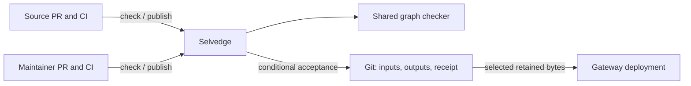

# Selvedge from first principles

Status: proposed replacement direction, 2026-11-01. The user asked to reconsider
the entire system using agent instructions and global simplicity. This reopens
mechanism choices, including earlier ADRs, without marking replacements accepted
or authorizing implementation. Accepted contracts remain recorded in
[the current design](../design.md).

## Begin with the useful result

A developer needs trustworthy feedback on a proposed subgraph's contribution to
the complete federation. An operator needs a coherent graph artifact whose exact
inputs, evaluation, and acceptance can be recovered. Gateway deployment needs
to select that artifact deliberately. These results do not inherently require
Selvedge to manage PRs, own pending jobs, interpret executable policy, or copy
every artifact into another store.

The previous review improved locality inside the accumulated design. It did not
sufficiently question the lifecycles the system had acquired. The largest
avoidable costs arise from making the storage repository both a human review
surface and the atomic record of generated snapshots, and from treating artifact
distribution as another mandatory publication.

| Retain as an outcome or guarantee | Reconsider as a mechanism or product choice |
| --- | --- |
| Complete Federation validity, public API classification, optional operation evidence, visible Federation changes | Composition entry point, language, process layout |
| Trusted checking and scoped authority; source-owned approval and compatibility exceptions | CI transport, storage-PR automation, command interfaces |
| Exact accepted input/output binding, durable recovery, no lost unrelated updates | Git or database, receipt representation, release assets |
| Forward source progress and indivisible coordinated batches | Ancestry acquisition, scheduling, control publication protocol |
| Explicit artifact selection and honest source/build/runtime evidence | Retrieval transport, deployment bundling, optional mirrors |

Source-only schema authority, no mirrored source-review PRs, and no automatic
revival of rejected requests remain valuable constraints. Relaxing them can
produce other coherent systems, but is not a free simplification.

## Compare whole systems

**CI-only:** a portable checker and trusted central publisher remove runtime
hosting and can use native PR review. They must still solve trusted source
checks, cross-repository submission, credential isolation, exact artifact handoff,
result association, and recovery. A desired-input branch can accumulate rejected
work that a later change makes publishable, altering caller-owned retry semantics.
A reusable workflow does not create an independently privileged central context.
The [CI comparison](../research/first-principles-ci.md) records current GitHub
capabilities and these costs. This can win with suitable existing CI governance;
no supplied topology establishes that today.

**Service plus database:** store accepted inputs, outputs, reports, receipts, and
head in one transaction, and serve selected artifacts directly. Receipt lookup
is straightforward. Database deployment, migration, credentials, capacity,
backup, and restore become operational responsibilities. Fresh composition,
source ordering, current authority, and uncertain-commit recovery remain.
Git already supports coherent conditional acceptance, so atomicity alone does
not justify replacement. The [transactional comparison](../research/first-principles-transactional.md)
identifies where existing database operations could make this cheaper.

**Narrow service plus Git:** centralize trusted reporting and scoped publication
for independent callers; use Git for machine-written accepted snapshots; let CI
own attempts; retrieve retained artifacts directly. This deletes special
storage-PR finalization and mandatory release distribution while preserving the
useful acceptance mechanism. It retains a privileged process, Git host dependency,
history growth, ancestry reads, and retention/restore obligations. See the
[narrow publisher comparison](../research/first-principles-git-publisher.md).

**Existing registry product:** the handoff rejected subscription control planes
and identified self-hosted Hive as the strongest broader alternative. Hive's
current evaluation stack includes PostgreSQL, ClickHouse, Redis, Redpanda, and
object storage plus several application services. That is real operational
scope, but an existing product also avoids custom registry maintenance. The
present narrow workflow does not justify adopting the whole stack; usage
analytics, a governance UI, or more workflow automation would warrant revisiting
that conclusion before building them here. This is a scope comparison, not a
deployment or total-cost measurement.
[Hive self-hosting](https://the-guild.dev/graphql/hive/docs/schema-registry/self-hosting/get-started).

**Recommendation:** the narrow Git-backed publisher currently has the strongest
total-cost argument. This is an engineering inference, not a measurement proving
Git or a hosted process universally preferable. OIDC alone does not make a server
necessary; concrete trusted submission and reporting are what it centralizes.

## Recommended operating model

### One publication lifecycle for authored inputs

Source CI generates identified SDL and requests a check. Source repository
controls decide approval and compatibility exceptions. After merge, trusted CI
publishes the exact source revision and submitted bytes. Selvedge constructs the
complete candidate against the latest accepted graph, evaluates it, and
conditionally retains inputs, outputs, and receipt together.

Maintainer configuration uses the same pattern. Ordinary protected PRs review
routing, operation documents, membership, and graph grants in their source
repository. This may be existing application/operator configuration; a dedicated
additional repository is not required. Trusted post-merge CI submits the exact
complete reviewed control snapshot. The accepted storage repository receives
only machine-written snapshots and has no human PR merge workflow.

This revisits Q27's earlier merge-then-publish option. Moving review into ordinary
source configuration does not eliminate reviewed versus effective state. The
benefit is eliminating Selvedge's special PR finalizer and control-change patch
protocol, while using an existing publication lifecycle. A single accepted
branch with Selvedge-managed merges removes a branch but adds review-authority,
command, cancellation, and PR-completion responsibilities to Selvedge.

The proposed control contract is deliberately cumulative: each approved source
revision authorizes its complete maintained-input snapshot. Record its source
progress separately from each subgraph and reuse forward-ancestry ordering.
An older control revision cannot restore controls after a newer acceptance,
even when the newer revision has identical bytes. Independent schema updates
are preserved and recomposed. There are no per-PR control patches to rebase.

Suppose A changes routing but fails publication. B is later reviewed with A's
routing change plus a corpus correction. B's explicit publication may accept the
complete snapshot if valid. This is a new authorized intent, not an automatic
retry of A. The report must show the full net change from accepted controls,
including inherited unpublished changes; B's incremental Git diff alone hides
its effective impact. That report remains scoped to its evaluated baseline.

**Merge establishes approval; the receipt establishes effectiveness.** A reviewed
revert does not withdraw a pending older snapshot until a successor is published
or current admission authority is revoked. One bounded admitted attempt is not
continuously cancellable through later source events. Current accepted grants
still govern each attempt and contention retry; proposed grants cannot authorize
their own publisher. This lifetime needs agreement, particularly for grant changes.

Strict effective-control predecessors are an alternative when failed A must
stop B until deliberate reconciliation. They add predecessor repair and dependent
pipeline blocking. Prefer cumulative snapshots if maintainers accept inherited
changes and the effectiveness rule above. This retains reviewed versus effective
state honestly; it makes that distinction consistent with source publication.

### Let CI own attempts

The service accepts bounded requests and returns identified results. The CI run
owns terminal attempt status and explicit retry. A run ID is not a publication
identity: retrying accepted work returns its original receipt even after later
graph updates. Rejection creates no eventual-publication promise; an unknown
write requires receipt reconciliation before another acceptance attempt.

No service-owned webhook inbox, PR inventory, automatic rejected-work replay,
comment authorization, or PR-status reconciliation is needed. If comment
initiation later improves usability, a trusted `issue_comment` workflow can call
the same publisher. GitHub documents its default-branch context; actor authority,
immutable inputs, and rerun rules still require verification. This is an optional
caller, not a publisher-owned review lifecycle.
[Workflow events](https://docs.github.com/en/actions/reference/workflows-and-actions/events-that-trigger-workflows#issue_comment).

CI scheduling is not exactly-once or guaranteed delivery. A missing or failed run
needs caller attention or explicit retry. Successful receipts remain durable
after CI logs expire. No database of rejected attempts is needed unless the
product later promises automatic work recovery or permanent rejection audit.

### Deliver the artifact already retained

A deployment job selects an accepted revision, verifies its artifact identity,
and bundles those exact bytes into the gateway deployment. Historical retrieval
does not rerun the old compiler. Read access still requires an authorized
deployment identity; choose Git/API transport for the actual deployment pipeline.

Make GitHub releases optional copies when a consumer needs them. This removes
mandatory upload reconciliation and a second availability status from the core
workflow without weakening accepted-byte retention. Apollo Gateway accepts a
provided `supergraphSdl` string; the actual version and representative startup
still need testing. [Gateway setup](https://www.apollographql.com/docs/apollo-server/using-federation/apollo-gateway-setup).

The registry stays outside gateway request execution. Existing deployments keep
their bundled artifact during registry outages. An old artifact does not make
incompatible deployed subgraphs support it; readiness and rollback remain
external deployment responsibilities.

### Release executable behavior as software

The checker is a released program with pinned dependencies and fixed
classification behavior. Snapshots record its exact release and consumed data.
Avoid a per-graph executable selector, policy language, or plugin loader without
a concrete requirement. Routing, corpus, membership, and grants remain graph data.

Software upgrades receive normal maintainer code review and isolated validation
against representative fixtures and current accepted inputs. This differs from
requiring the old checker to govern admission of new executable behavior and
explicitly revises that part of ADR 0013. An explicit unchanged-input publication
can produce an artifact with the new release. Code deployment alone neither
activates a gateway artifact nor rewrites accepted snapshots.

Initially permit one active writing release. Quiesce old writers and reconcile
outstanding acceptance before cutover; otherwise publication stays unavailable.
Release identity is evidence, not a fence against an older writer. Uninterrupted
mixed-version writes require an additional compatibility/fencing contract. If
new composition tooling rejects the current graph, retained artifacts stay
readable. Corrected source/configuration may publish only through the comparison
contract below; unsupported historical inputs require corrected tooling. These
upgrade and availability costs remain real.

An accepted comparison baseline is its retained public API and supergraph,
bound to its accepted inputs and checker release. Compose the candidate with the
new release; do not regenerate the before side under that release. This exposes
tool-induced output changes even when source inputs are unchanged and permits
corrective publication when new composition rules reject the old graph inputs.
The baseline corpus remains fixed and is checked against both public schemas
with the current operation validator; old reports remain evidence of their
original evaluation, not substitutes for this comparison. Unsupported baseline
decoding or analysis is unavailable evidence, never a pass or fresh bootstrap.

This explicitly revises the earlier research recommendation to
[compose both sides with one engine](../research/validation-assurance.md#smallest-coherent-release-recommendation)
when the baseline is an accepted snapshot. Standalone directory comparisons can
still compose both supplied inputs with a pinned release and label that scope.
Neither comparison establishes which artifact a deployed gateway is using.

Language follows integration correctness. Rust remains a preference, not a reason
to rebuild an analyzer or maintain unnecessary cross-language machinery. A single
TypeScript implementation could simplify Apollo/Inspector integration if it meets
the required behavior; it is not selected here. Apollo documents new validation
behavior in Rust-based Federation 2.15, while a JavaScript composition API also
exists. Choose the engine against actual schemas and the gateway before fixing
packaging; the JavaScript API alone does not establish parity.
[Federation versions](https://www.apollographql.com/docs/graphos/schema-design/federated-schemas/reference/versions),
[JavaScript composition source](https://github.com/apollographql/federation/blob/main/composition-js/src/compose.ts).

## Safeguards that still earn their cost

The publisher must retain immutable bounded inputs, current scope checks,
complete-graph evaluation, baseline operation evidence, indivisible batches,
source ordering, conditional acceptance, bounded contention retry, and original
receipt recovery. It must reread the accepted head before semantic rejection,
keep compatibility failures visible after external approval, and distinguish
unknown acceptance from failure. These prevent concrete errors independently
of the storage backend; exposing them to every caller does not simplify them.

Accepted history, outputs, and receipts retain the no-automatic-expiry guarantee.
Git hosting does not replace backup/restore planning: missing receipts after a
known restore gap do not prove requests never succeeded. Use ordinary Git/source
revisions, payload identity, and artifact digests for their distinct purposes.
A linear machine-written history removes the need to distinguish proposal merge
parents from accepted snapshots. No second object store or workflow state model
is justified by the current outcomes.

## Remaining source contracts: explicit proposed defaults

These recommendations require agreement and inspection of the actual producers:

1. A PR result certifies its recorded bytes and baseline. Publication checks its
   own bytes freshly and does not require a reusable green-check token or become
   another approval gate. It must not claim that an earlier check covered changed
   post-merge SDL. Source workflows own generator trust. Requiring exact prior
   checked bytes would be an additional build contract; OIDC does not provide it.
2. For one graph/subgraph/source revision, initially accept one declared SDL
   value. Different bytes are an integrity conflict; legitimate generation
   changes need a new recorded source revision. This simplifies ordering but
   constrains non-reproducible or externally configured generators. If a real
   producer needs variants, specify their identity and ordering before accepting
   that producer; a fresh request UUID does not resolve the issue.
3. Membership changes require one complete authorized batch. A current maintainer
   onboarding grant must cover maintained inputs and the initial schema
   contribution; proposed source grants cannot bootstrap their own authority.
   Agree the grant and required source evidence explicitly. Routine source
   publishers remain limited to their existing subgraphs.

These choices do not prove source-to-SDL linkage, make source approval and graph
acceptance atomic, or automate coordinated deployment.

## Decision changes required

| Existing direction | Proposed treatment | Consequence |
| --- | --- | --- |
| ADR 0010: snapshots plus immutable release distribution | Retain atomic Git snapshots; make release copies optional | Deployment retrieves the selected retained bundle; no mandatory upload stage |
| ADR 0013 and pending Q27: dedicated control-PR finalization | Native configuration PRs followed by explicit CI publication of complete reviewed snapshots | Merged controls may not be effective; inherited unpublished changes and published-successor revocation are explicit |
| ADR 0013: old controls govern tool/policy transition | Current grants still govern data; executable policy changes through reviewed software releases | Separate upgrade assurance and single-writing-release cutover replace dynamic tool admission |
| Research recommendation: recompose both comparison sides | Use retained accepted outputs as the before side; compose the candidate with the selected release | Tool-induced changes remain visible; new rejection of old graph inputs does not itself prevent corrective publication |
| Per-PR control delta/predecessor alternatives | Forward ordering of complete maintained-input snapshots | Reuses source ordering; a newer authorized snapshot may include earlier rejected changes |
| Open source correspondence/generation questions | Snapshot-scoped checks and one SDL per subject/revision initially | No check-token approval protocol; producer determinism is an explicit constraint |
| ADRs 0001-0005, 0007-0009, 0011-0012, 0014 | Retain applicable assurance, source approval, scope, ordering, recovery, OIDC, and activation guarantees | Control-history ordering is a proposed extension, not an already accepted rule |

No ADR changes through this review. Adoption requires recording chosen revisions,
including authority lifetime and upgrade assurance. There is no application data
to migrate today. Future migration cost still favors existing accepted-history
representation unless another store demonstrates a concrete advantage.

## Evidence and next proof

Three independent alternatives were investigated against the same developer and
operator outcomes. Their notes distinguish current primary sources from design
inference. No schema fixture, hosted workflow, publication, database, or gateway
experiment was executed for this reconsideration.

Before implementation architecture becomes a commitment, prove one realistic
path: representative subgraphs through the chosen engines; their artifact in
the actual gateway; one source PR and trusted post-merge submission; and one
maintainer update through the common publisher. Exercise concurrency, stale
rejection, lost responses, current-authority changes, and exact historical reads.
For upgrades, exercise an old accepted graph rejected by the new composer, a
corrective candidate that can publish against its retained baseline, output
changes caused solely by tooling, and unavailable historical decoding.
For cumulative controls, trace failed A, new B including A, a published revert,
and a delayed A retry. Revisit CI-only with an actual trusted submission flow;
revisit a database if existing operations or measured Git limits justify it.

An independent agent reviewed the complete proposal against the request,
repository instructions, handoff, and accepted contracts. It identified the
cross-release baseline gap: recomposing an old graph with new rules could block
corrective publication and obscure tool-induced changes. The comparison contract
and proof cases above address it; the reviewer rechecked the revision and found
no remaining material issue. This is static review evidence, not executed
upgrade, recovery, or host verification. Local documentation links, anchors, and
whitespace were checked; no Markdown formatter is configured.
